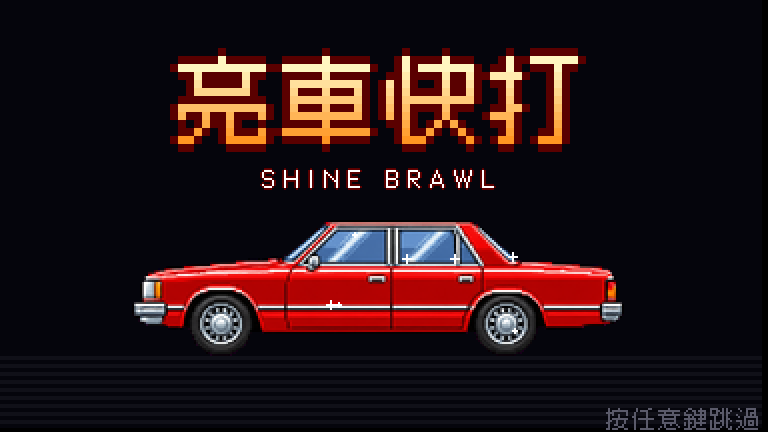

# 街機像素遊戲工坊（arcade-game-maker）

做 90 年代街機風格網頁小遊戲的 Claude Code skill：用 GPT 畫逐格動作圖與像素背景，程式切格對齊、合成配樂、手機觸控、上線到 GitHub Pages。

展示頁（作品、範本、流程）：https://pokemonida99.github.io/arcade-game-maker/



## 用這套做出來的遊戲
| 遊戲 | 類型 | 線上玩 |
|---|---|---|
| 紅分子 亮車快打 | 快打旋風打車獎勵關反過來：把髒車打到發亮；8 位角色、4 關、飛天電動車 | https://pokemonida99.github.io/hjaec-fighter/ |
| 讓子彈飛：鵝城快打 | 橫向清版；騎馬劫火車、鴻門宴過場、多結局 | https://pokemonida99.github.io/bullets-fly/ |
| 沙包練習場（範本） | 這個 repo 的 `template/`，最小可玩範例 | https://pokemonida99.github.io/arcade-game-maker/template/ |

## 安裝成 skill
```bash
git clone https://github.com/pokemonida99/arcade-game-maker.git
ln -s "$PWD/arcade-game-maker" ~/.claude/skills/arcade-game-maker
```
之後跟 Claude 說「做一款街機風的小遊戲」「橫向清版」「快打風」之類，就會照 `SKILL.md` 的流程做。

## 內容
```
SKILL.md                 skill 入口：流程 0～7、使用者偏好
references/
  01-planning.md         企劃：玩法類型、角色表、關卡表、改編與品牌規則
  02-gpt-art.md          GPT 生圖：動作表 A/B/C/D 規則、頭像、背景、道具、額度、檢查
  03-slicing.md          切圖：slice.py 原理與常見問題、stage_art.py、官方商品照
  04-engine.md           引擎：檔案結構、狀態機、打擊感、必備介面、防誤觸
  05-audio.md            音序器格式、每個場景的配樂、音效清單
  06-testing.md          手動推進格數、截圖、自動遊玩 bot、全流程檢查
  07-release.md          GitHub Pages 上線、版本號、更新紀錄、回報方式
  checklist.md           交付前檢查清單
scripts/
  gen.sh                 用 ChatGPT.app 的 codex 生一張圖
  run_jobs.sh            平行生一批（已生的跳過）
  make_jobs_example.py   工作清單範本（提示詞都在這裡）
  slice.py               切動作表 → js/sprite_data.js（設定：slice_config.json）
  stage_art.py           背景、道具、頭像 → js/art_data.js（設定：art_config.json）
  check_sprites.py       檢查切好的格有沒有破圖
  bump.sh                index.html 的 ?v= 一起加一
  snapshot_server.py     測試截圖用的小伺服器
  bot_example.js         自動遊玩 bot 範例
template/                可玩範本「沙包練習場」：直接複製成新專案
examples/                展示頁用的截圖
```

## 範本怎麼開
```bash
cd template && python3 -m http.server 4400
# 瀏覽器開 http://localhost:4400
```
操作：方向鍵／WASD 移動（連按兩下或按住會跑）、↑ 跳、↓ 蹲、J 拳、K 腳、L 飛彈（或 ↓↓＋拳）、I 迴旋（或 ↓↓＋腳）、Esc 暫停。手機有觸控按鍵。

## 授權
- 程式：MIT。
- 字型：俐方體 11 號（Cubic 11），見 `template/fonts/OFL.txt`，可商用。
- 範本裡的角色與背景圖取自《紅分子 亮車快打》（GPT 依使用者的角色設定繪製），僅作範例；做新遊戲請換成自己的美術。
